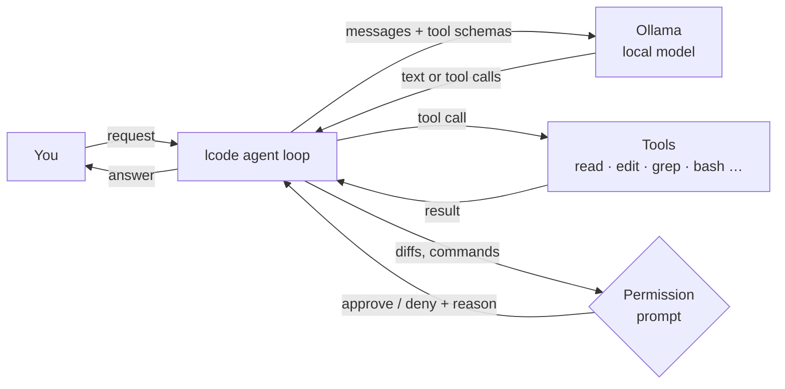

# How it works

lcode is a small Python program (about 2,000 lines) around one idea: let a local model call tools in
a loop until the task is done.

## The agent loop

1. Your message goes to the model along with a system prompt (environment, repository layout,
   `AGENTS.md`, the index of [memory notes](memory.md)) and the JSON schemas of the tools.
2. The response streams back. Reasoning shows as a spinner (or text with `--show-thinking`); the
   answer is rendered as markdown, block by block.
3. If the model called tools, lcode runs them, asking for permission where needed, and appends the
   results to the conversation.
4. Back to step 2 until the model answers without calling a tool (with a safety cap of 150 steps).

All tools return text, and failures come back to the model as `Error: …` messages rather than
crashing the session, so the model can correct itself (for example re-read a file when an edit
didn't match).

### Checking its own work

Small models like to call work done after a syntax check. The system prompt tells the model what
counts as checked:

- run what it changed the way it will be used;
- reproduce a bug before fixing it, then show it's gone;
- check what it can't see (a GUI, a web page, a layout) without a screen: Qt's `offscreen`
  platform, a headless browser, or a script that prints sizes or renders an image it then looks
  at;
- never mark a task done or call something tested without having run it, and tell you what to
  look at when it couldn't check.

### When the model repeats itself

Small models sometimes fall into a loop: they make a call, get a result, and make the very same call
again, and again. lcode counts, within a request, the calls that repeat an earlier one exactly: the
same tool, the same arguments and the same result.

- **At the third one** (the second, when the call failed) the result gets a note: the call returned
  the same thing several times, so the model should use what it got, try something different, or
  tell you what's blocking it.
- **Two more,** and lcode ends the request with
  `Stopped: the model kept making the same call with the same result`. The JSON output's status is
  `loop`.

A result that changes isn't a repeat, so a test that's run again after a fix, or a background job
that's checked while it runs, never adds up. A call that may have changed something, like an edit or
a shell command that isn't read-only, starts the count again for the other calls: checking the build
after each edit is fine. Change the threshold with `lcode config set repeat_limit 5`, or turn it off
with `0` (that also turns off the checks for unreachable sites and for thinking in circles, below).

### When a site can't be reached

A download that fails however its address is written usually means this machine can't reach the
site: a firewall, a proxy, a regional block, or no internet. No address the model tries will fix
that, and every attempt differs, so the repeat count above never fires. lcode keeps track, per site,
of the calls that failed to reach it (an HTTP error, a name that doesn't resolve, a refused or
timed-out connection) and of the ones that got an answer.

- **When three different calls failed for a site and none worked,** the result gets a note: check
  one address on that site that must exist, and if that fails too, stop and tell you what fails
  and what you could do (another network or a VPN, a proxy, a mirror, or running that step
  somewhere else, such as CI).
- **Two more,** and lcode ends the request with `Stopped: every request to dl.google.com failed (5
  calls: HTTP 404)…`. The JSON output's status is `blocked`.

A site that answered once in the request is never counted as out of reach, so a wrong address on a
working site doesn't add up. Local addresses (localhost, private networks, names without a dot)
aren't tracked.

### When a reply goes nowhere

Small models sometimes think in circles: a few paragraphs, over and over, until the context is full.
That takes minutes behind the spinner and ends without an answer. lcode watches the thinking as it
streams, and when its sentences keep repeating, it stops the model, drops that reply and asks for a
short one: the next tool call, or what's blocking it. An empty reply, or one that filled the context
before it said anything, gets the same second chance. The second time in a request, lcode stops it
(status `loop`), offering the [stronger model](usage.md#a-stronger-model-when-stuck) first when one
is set. An answer the context cut off midway is kept, with a warning to `/compact` or use a larger
`/context`.

## Subagents

The `agent` tool starts a [subagent](agents.md): another agent loop with its own conversation, the
same model and context window (so Ollama doesn't reload anything), the session's permissions,
sandbox and checkpoints, and a filtered set of tools. Only its final report goes back into the main
conversation. Several subagents run in threads when `max_parallel_agents` allows; their permission
prompts are queued and asked in the main thread. Workers that edit files at the same time each work
in a temporary git worktree, and their changes come back as a diff.

## Context management

Ollama keeps the processed conversation in its KV cache, so each turn only processes the new tokens.
lcode tracks how full the window is from Ollama's token counts. It makes room when the window is
85% full, or when the conversation reaches 64K tokens (`compact_at`), whichever comes first.
Small models lose track in long contexts well before a large window is full: in one long session,
Qwen3.6 35B started repeating itself and overlooking what it had read once the conversation passed
about 75K tokens. Most of a long session's
context is old tool output, so:

1. **lcode removes old tool output first.** File contents, command output and search results from
   before your last two requests become one-line notes that say what was there, such as
   `[lcode: read src/app.py earlier; its content was removed …. Read it again before answering anything about it.]`.
   An earlier copy of a file that was read again later goes too, even in recent requests. Subagent
   reports, skill instructions and the approved plan stay. The files whose only copy went are also
   named next to the request the model is working on, since models tend to overlook a note deep in
   the conversation and answer from memory instead of reading the file again.
2. **If that brings the conversation well under the limit** (70% of the window, or about 53K
   tokens with `compact_at`), the work simply continues: nothing is summarized,
   and the conversation itself stays word for word.
   If it's not, lcode also removes the tool output of your previous request, keeping only the
   latest one's. (`lcode config set prune false` skips this step.)
3. **Otherwise lcode summarizes.** It asks whether anything is worth [remembering](memory.md), since
   the summary leaves details out, then has the model write a summary of the conversation (goals,
   findings, files changed, next steps) and continues from it. Your latest requests (up to eight)
   are kept word for word under the summary, so the goal isn't lost in the retelling.

**The task sheet.** Next to the summary, and next to your request when old tool output is removed,
lcode pins a short sheet, so the state of the work survives:

- the plan (the model's todo list);
- the notes the model keeps with it (decisions and why, findings, open questions);
- the files changed in the session;
- the last check.

It's saved with the session, so `lcode -c` brings it back, and `/status` shows it to you.

`lcode config set compact_at 128k` moves the ceiling, and `0` turns it off, leaving only the 85%
rule. `/context` shows where the current session makes room.

Long tool output (over 30,000 characters) keeps its beginning, its end and the lines in between
that look like errors. The full output is saved under `~/.local/state/lcode/outputs/` (for a week)
and the model is told where, so it can read the rest if it needs to. `/context` shows what's using
the window, by category: the system prompt and its parts, tool definitions, your messages, attached
files, the model's replies and each tool's results.

## Memory sizing

`lcode setup` and `lcode models` estimate memory as *weights + KV cache per token × context +
overhead*. The per-token KV cost comes from each model's GGUF metadata (attention layers, KV heads
and head sizes); hybrid architectures such as Qwen3.5/3.6 (linear attention in 3 of 4 layers) and
Nemotron (Mamba layers) keep a cache in only a few layers, which is why they can offer 256K–1M
tokens on consumer hardware. The budget is GPU memory plus spare RAM on Linux, and the GPU share
of unified memory on Apple Silicon. See [Models & context windows](models.md#how-memory-is-estimated).

Two lessons from tuning the default model on a 12 GB GPU shaped the defaults:

- **Vision projectors cost ~1 GB of VRAM** that Ollama under-counts on small GPUs, causing
  out-of-memory crashes at large batch sizes. lcode creates text-only variants (`lcode-<key>`) that
  reuse the downloaded weights.
- **Prompt batch size dominates prompt-reading speed** when experts sit in system RAM: 512 → 280
  tokens/s, 1024 → 500 tokens/s. But the model's speculative-decoding context grows with the batch
  (0.8 GB at 512, 1.1 GB at 1024), and at 1024 it only fits next to a 256K cache on 12 GB when little
  else uses VRAM; otherwise CUDA fails with "illegal memory access". lcode therefore uses Ollama's
  default of 512 and, if a larger configured batch runs out of memory, retries with 512.

## Security model

lcode runs with your user's permissions and is not a sandbox. The permission prompts, the read-only
allowlist and the "read before edit" rule are guardrails against mistakes, not against a determined
attacker. Files and command output can contain prompt injections, so review commands before
approving them, and keep `yolo` mode for disposable environments. lcode sends no telemetry; besides
the Ollama server you configure, it only contacts the web when the model searches or fetches a page
(see [Web search](usage.md#web-search)). See the [security policy](https://github.com/nasser1941/lcode/blob/main/SECURITY.md).

## Code map

| Module | Responsibility |
|---|---|
| `cli.py` | Entry point, subcommands, model and context resolution |
| `repl.py` | Prompt, key bindings, slash commands, status bar |
| `agent.py` | System prompt, streaming, tool loop, compaction, sessions |
| `tools.py` | Tool schemas and implementations |
| `permissions.py` | Approval prompts and the read-only allowlist |
| `servers/` | The MCP servers lcode ships for services without one: Encord, Valohai |
| `mcp/` | MCP client: stdio and HTTP transports, OAuth sign-in, server settings, the catalog, `lcode mcp` |
| `bench.py` | `lcode bench`: the benchmark tasks, their checks and the reports |
| `vision.py` | Looking at images with a model that can see |
| `subagents.py` | Subagents: agent types, running them (also in parallel), worktrees for workers |
| `hooks.py` | Hooks on lcode's events, and allow and deny rules for permissions |
| `repomap.py`, `codesearch.py` | The repository map, and semantic code search with an embedding model |
| `lsp.py` | Language servers: the `lsp` tool and errors after edits |
| `extensions.py` | Custom commands and skills, and approving a repository's own |
| `frontmatter.py` | The `---` headers of notes, agents, commands and skills |
| `planning.py` | Plan mode: what it allows, presenting a plan and approving it |
| `memory.py` | Notes that carry over between sessions, and the end-of-session check |
| `sandbox.py` | The optional container for shell commands |
| `checkpoints.py` | Snapshots before the model changes files, for `/undo` and `/rewind` |
| `catalog.py`, `models.toml` | Model catalog and memory estimates |
| `hardware.py` | NVIDIA / Apple Silicon detection |
| `ollama.py` | Ollama HTTP client |
| `config.py` | Settings file and environment variables |
